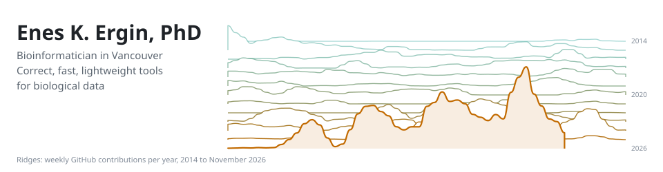
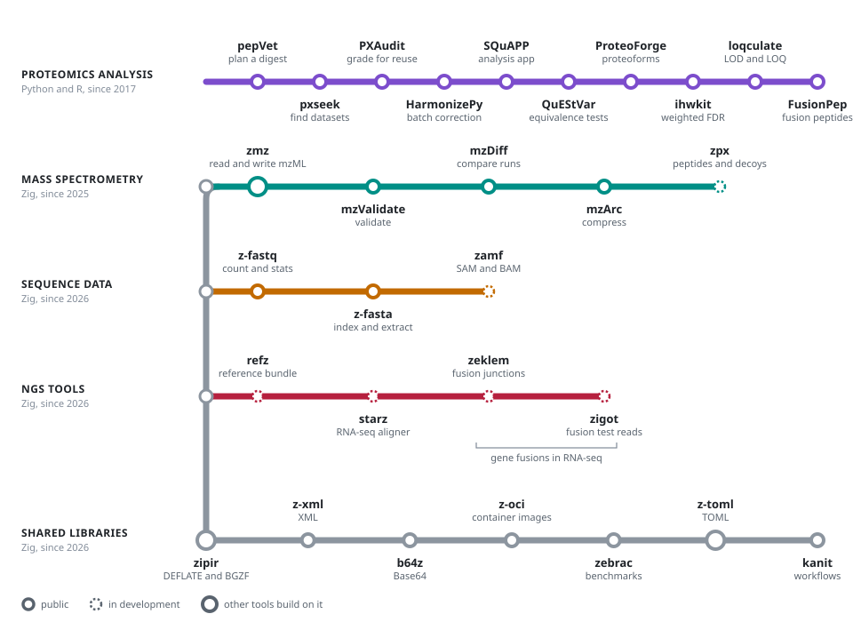

<!-- Generated by tools/build.py from tools/template.md and data/. Edit those and rebuild; changes made here are overwritten. -->

<picture>
  <source media="(prefers-color-scheme: dark)" srcset="assets/header-dark.svg">
  <source media="(prefers-color-scheme: light)" srcset="assets/header-light.svg">
  
</picture>

  
  
  

  
  
  

Welcome to my GitHub! What I share here is mostly bioinformatics tools: software that helps with proteomics data analysis, and small, fast programs that make large biological data easier to handle, even on modest hardware.

When I build a tool, I follow the same rules, in order of priority:

1. **Correctness.** Exhaustive checks and edge cases covered, with results compared against a reference or peer tool, so the answer is right.
2. **Speed.** Optimized to run as fast as it can, and measured against the tools people already use.
3. **Memory footprint.** Memory stays bounded instead of growing with the input, so precious resources are not wasted.
4. **Portability.** Few dependencies, and command-line tools ship as ready-to-run programs, so they run where the data is without a build step.

<picture>
  <source media="(prefers-color-scheme: dark)" srcset="assets/evidence-dark.svg">
  <source media="(prefers-color-scheme: light)" srcset="assets/evidence-light.svg">
  
</picture>

Same machine and inputs for both tools, measured in October 2026. Methods and caveats: [z-fasta](https://github.com/eneskemalergin/z-fasta/blob/main/bench/index/REPORT.md) | [zmz](https://github.com/eneskemalergin/zmz/wiki/Benchmarks) | [z-fastq](https://github.com/eneskemalergin/z-fastq/tree/main/bench/count) | [zipir](https://github.com/eneskemalergin/zipir/tree/main/bench/linux-x86-avx2)

### What I work on

Below is a high-level map of the repositories and tools I have built and maintain, including a few not yet on GitHub that I am still deciding whether to make public.

<picture>
  <source media="(prefers-color-scheme: dark)" srcset="assets/map-dark.svg">
  <source media="(prefers-color-scheme: light)" srcset="assets/map-light.svg">
  
</picture>

Tools marked in development will go public under the Apache 2.0 or MIT license once I feel they are ready.

<b>Proteomics analysis</b> | Python and R | 10 public

- **[pepVet](https://bioconductor.org/packages/pepVet/)**: Scores how well each protein digests before a run; in Bioconductor.
- **[pxseek](https://github.com/LangeLab/pxseek)**: Queries, filters, and downloads ProteomeXchange metadata, with a local cache.
- **[PXAudit](https://github.com/LangeLab/PXAudit)**: Grades PRIDE datasets for reuse on six FAIR-readiness tiers.
- **[HarmonizePy](https://github.com/LangeLab/HarmonizePy)**: Batch correction that tolerates missing values, ported from HarmonizR and checked against it.
- **[SQuAPP](https://github.com/LangeLab/SQuAPP)**: Shiny app for QC and quantitative analysis of proteins and PTMs, for people who do not code.
- **[QuEStVar](https://github.com/eneskemalergin/QuEStVar)**: Tests for equivalence beside difference, so a protein can be called stable, changed, or undetermined.
- **[ProteoForge](https://github.com/eneskemalergin/ProteoForge)**: Finds peptides that break from the rest of their protein and groups them into differential proteoforms.
- **[ihwkit](https://github.com/eneskemalergin/ihwkit)**: Independent Hypothesis Weighting in NumPy only, checked against Bioconductor IHW.
- **[loqculate](https://github.com/eneskemalergin/loqculate)**: Limits of detection and quantitation from calibration curves, with confidence intervals.
- **[FusionPep](https://github.com/LangeLab/FusionPep)**: Maps peptides onto a fusion protein and both parents, and checks which matches span the junction.

<b>Mass spectrometry</b> | Zig | 4 public, 1 in development

- **[zmz](https://github.com/eneskemalergin/zmz)**: mzML reader and writer that streams in a few MiB; the other tools on this line build on it.
- **[mzValidate](https://github.com/eneskemalergin/mzValidate)**: Validates mzML in one streaming pass.
- **[mzDiff](https://github.com/eneskemalergin/mzDiff)**: Compares two mzML files by meaning rather than bytes, in bounded memory.
- **[mzArc](https://github.com/eneskemalergin/mzarc)**: Compresses mzML, byte-exact when asked, in about 1 MiB of memory.
- **zpx** *(in development)*: Turns a protein FASTA into exactly defined peptide sets for a search: digestion, Unimod modifications, and target-decoy databases, streaming in bounded memory.

<b>Sequence data</b> | Zig | 2 public, 1 in development

- **[z-fastq](https://github.com/eneskemalergin/z-fastq)**: Counts, summarizes, and validates FASTQ, plain or gzip, in a few MiB for most jobs.
- **[z-fasta](https://github.com/eneskemalergin/z-fasta)**: Indexes, extracts, and validates FASTA, writing samtools-compatible .fai files.
- **zamf** *(in development)*: SAM and BAM toolkit in fixed memory that takes SAMtools' option letters.

<b>NGS tools</b> | Zig | 4 in development

- **refz** *(in development)*: Builds one versioned reference from the genome, GENCODE, MANE, and HGNC that every tool maps from disk, so they all agree on genes, exons, and coordinates.
- **starz** *(in development)*: Spliced RNA-seq aligner that follows STAR's method and takes STAR's option names, on one thread with a shared reference.
- Gene fusions in RNA-seq:
  - **zeklem** *(in development)*: Finds listed fusion junctions straight from paired FASTQ, with a sensitivity estimate behind every negative.
  - **zigot** *(in development)*: Simulates RNA-seq libraries with per-read truth from declared fusions, for testing callers.

<b>Shared libraries</b> | Zig | 7 public

- **[zipir](https://github.com/eneskemalergin/zipir)**: gzip, zlib, DEFLATE, BGZF, and tar with no dependencies, in fixed memory.
- **[z-xml](https://github.com/eneskemalergin/z-xml)**: XML event reader, document model, and streaming writer.
- **[b64z](https://github.com/eneskemalergin/b64z)**: Strict RFC 4648 Base64 with scalar and AVX2 paths.
- **[z-oci](https://github.com/eneskemalergin/z-oci)**: Read-only client for OCI and Docker registries, with digest checks.
- **[zebrac](https://github.com/eneskemalergin/zebrac)**: Benchmarks commands on Linux with hardware counters and peak memory.
- **[z-toml](https://github.com/eneskemalergin/z-toml)**: TOML 1.1.0 parser, checked against the official test corpus.
- **[kanit](https://github.com/Zenteomics/kanit)**: Workflow engine for one Linux workstation: every task within budget, every attempt on record.

### Where the work lives

-  **[Zenteomics](https://github.com/Zenteomics)**: my one-person practice for proteomics analysis and gene fusion calling. Public so far: [kanit](https://github.com/Zenteomics/kanit) and [awesome-proteomics](https://github.com/Zenteomics/awesome-proteomics).
-  **[Lange Lab](https://github.com/LangeLab)**: where I did my PhD and still consult; home of most of the proteomics analysis tools.
-  **[WTHecksum](https://github.com/wthecksum)**: a learning project on checksum algorithms, starting with CRC-32 and Adler-32.

### Papers

First author: [ProteoForge](https://doi.org/10.1021/acs.jproteome.5c01235) (J. Proteome Res., 2026), [QuEStVar](https://doi.org/10.1021/acs.jproteome.4c00131) (J. Proteome Res., 2024), [SQuAPP](https://doi.org/10.1093/bioinformatics/btac628) (Bioinformatics, 2022), and my [PhD thesis](https://open.library.ubc.ca/cIRcle/collections/ubctheses/24/items/1.0448334) (UBC, 2025). Co-author in [Nature Communications](https://doi.org/10.1038/s41467-023-42701-9) and [EMBO Molecular Medicine](https://doi.org/10.1038/s44321-025-00212-8); the rest is on [Google Scholar](https://scholar.google.com/citations?user=6iZzHecAAAAJ).
